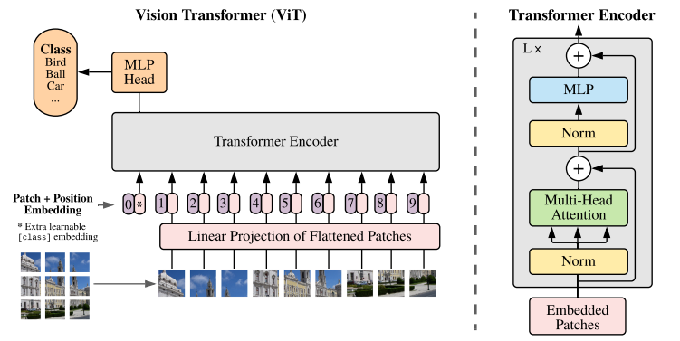

# DeepSeek V4\.1 image

### vision\_config

```JSON
"vision_config": {
    "model_type": "deepseek_v41_vision",
    "num_hidden_layers": 32,
    "hidden_size": 1024,
    "num_attention_heads": 16,
    "intermediate_size": 2816,
    "patch_size": 14,         // 图片切块  num_patch = h/patch x w/patch
    "rope_theta": 10000,
    "downsample_ratio": 3,    // 下采样 
    "max_image_tokens": 1024, // image最大token数
    "min_pixels": 295936,     // 最小像素点
    "max_wh_ratio": null      // 最大宽高比
  }
```

### Image preprocess

根据**最大的图片宽高比**，**最小像素点**，**图片的最大token数，**调整图片宽高

```Plain Text
def load_image(
    image: Image.Image,
    *,
    patch_size: int,
    downsample_ratio: int,
    max_n_token: int,
    min_pixels: int,
    max_wh_ratio: float | None,
):


  input:  
    image: Image.open
    patch_size: 图片分块大小 = 14
    dowmsample_ratio: 下采样 = 3
    max_n_token: 图片转换成的最大tokens
    min_pixels: 最小像素点
    max_wh_ratio: 最大的宽高比
    
  output:
    patches: torch.Tensor**
        shape: [patches, C, patch_size, patch_size] = [num_patches, 3, 14, 14]**
               patches = n_vit_h * n_vit_w**
        dtype: bfloat16**
       
   n_vit_h: int
        vit input 块高 = best_height(调整后) // patch_size =  best_height // 14
       
   n_vit_w: int
        vit input 块宽 = best_width(调整后) // patch_size = best_width // 14
       
   n_llm_h: int
        llm input的块高 = math.ceil((best_height // patch_size) / downsample_ratio)
                      = math.ceil((best_height // 14) / 3)
                
   n_llm_w: int
        llm input的块宽 = math.ceil((best_width // patch_size) / downsample_ratio)
                      = math.ceil((best_width // 14) / 3)
                    
   ### num_images_token = n_llm_h * (n_llm_w + 1) + 2
   ### images的token计算，包括分隔token 
   ### [IMAGE_START] + ([IMAGE] * n_llm_w + [IMAGE_NEW_LINE]) * n_llm_h+ [IMAGE_END]
```

### ViT


```Plain Text
1. DeepseekV4PatchEmbed:
    input:  x * weight + bias
       x:
           shape: [patches, C, patch_size, patch_size] = [patches, 3, 14, 14]
           dtype: torch.bfloat16
       
       vision.patch_embed.proj.weight:
           shape: [vision_dim, 3*patch_size] = [1024, 588] 
           dtype: torch.bfloat16
           
       vision.bias:
           shape: [vision_dim]
           dtype: torch.bfloat16
    output:
          shape: [patches, hidden_size] = [patches, 1024]
          dtype: torch.bfloat16

2. ImagesApply2DRope:
  input: 2d_rope
       rope_dim = hidden_size // num_attention_heads // 2 = 1024 // 32 // 2 = 16
       rope_theta = 10000
       
  output:   
       shape: [patches, hidden_size] = [patches, 1024]
       dtype: torch.bfloat16
          
3. DeepseekV4VisionBlock * vision_num_hidden_layers**:
    3.1 DeepseekV4RMSNorm:
        input: rmsnorm
            x: 
                shape: [patches, vision_dim] = [patches, 1024]
                dtype: torch.bfloat16  
             
            vision.blocks.0.norm1.weight:
                shape: [hidden_size] = [1024]
                dtype: torch.float32
        output: 
            shape: [patches, hidden_size] = [patches, 1024]
            dtype: torch.bfloat16   
      
    3.2 DeepseekV4VisionAttention:
        input: wqkv(x) -> q, k, v
            vision.blocks.2.attn.wqkv.weight:
                shape: [3*hidden_size, hidden_size] = [3072, 1024]
                dtype: torch.bfloat16
            vision.blocks.2.attn.wqkv.bias:             
                shape: [hidden_size] = [1024]
                dtype: torch.float32  
        output:
            shape: [patches, 3*hidden_size] = [patches, 3072]
            dtype: torch.bfloat16

        input: **rope(q), rope(k) -> attn(q, k, v) -> o**
            q, k, v:
                shape: [patches, hidden_size] = [patches, 1024]
                dtype: torch.bfloat16
        output:
            o:
                shape: [patches, hidden_size] = [patches, 1024]
                dtype: torch.bfloat16

        input: **wo(o) -> 0**
            vision.blocks.x.attn.wo.weight:
                shape: [hidden_size, hidden_size] = [1024, 1024]
                dtype: torch.bfloat16
            vision.blocks.x.attn.wo.bias:
                shape: [hidden_size, hidden_size] = [1024, 1024]
                dtype: torch.bfloat16
        output:
            o:
                shape: [patches, hidden_size] = [patches, 1024]
                dtype: torch.bfloat16
        
    3.3 DeepseekV4RMSNorm:**
        input: 
            x: 
                shape: [patches, hidden_size] = [patches, 1024]
                dtype: torch.bfloat16  
             
            vision.blocks.0.norm2.weight:
                shape: [vision_dim] = [1024]
                dtype: torch.float32
        output: 
                shape: [patches, hidden_size] = [patches, 1024]
                dtype: torch.bfloat16   
  
    3.4. DeepseekV4VisionMLP
        input: 
            attn_output: **w1(x) -> silu_and_mul(x) -> w2(x)**
                shape: [patches, vision_dim] = [patches, 1024]
                dtype: torch.bfloat16  

            vision.blocks.x.mlp.w1.weight: 
                shape: [2*intermediate_size, vision.hidden_size] = [1024]
                dtype: torch.bfloat16
             
            vision.blocks.x.mlp.w2.weight
                shape: [hidden_size, intermediate_size] = [1024]
                dtype: torch.bfloat16
        output: 
            shape: [patches, hidden_size] = [patches, 1024]
            dtype: torch.bfloat16   

```

### Aligner \(图像特征映射到语言模型隐层空间\)

```Plain Text
DeepseekV4Aligner
Aligner（对齐器/投影器） 的核心作用是将视觉编码器（ViT）提取的图像特征映射到语言模型（LLM）主干网络可以接受的隐层空间，实现图文多模态特征的对齐与融合。

    downsample:
        r = self.downsample_ratio
        x = x.view(n_vit_h, n_vit_w, -1).permute(2, 0, 1)
        ## pad，使得宽高都等整除r
        x = F.pad(x, (0, -n_vit_w % r, 0, -n_vit_h % r))
        ##  空间上相邻的r×r个视觉 Token合并
        x = F.unfold(x.unsqueeze(0), r, stride=r).squeeze(0).transpose(0, 1)
    input:   
        vit_output:
            shape: [patches, hidden_size] = [patches, 1024]
            dtype: torch.bfloat16     
        output: 
            shape: [patches / 9, 9 * vision.hidden_size] = [patches / 9, 9216]
            dtype: torch.bfloat16     
  
    input: **self.w1(x) -> self.w2(F.gelu(hidden))**
        downsample_output:
            shape: [patches / 9, 9 * vision.hidden_size] = [patches, 9216]
            dtype: torch.bfloat16  
          
    aligner.w1.weight:
        shape: [text.hidden_size,vision.hidden_size*downsample_ratio*downsample_ratio]
               [5120, 9216]
        dtype: torch.bfloat16
       
    aligner.w1.bias
        shape: [text.hidden_size] = [5120]
        dtype: torch.bfloat16
        
    aligner.w2.weight
        shape: [text.hidden_size, text.hidden_size] = [5120]
        dtype: torch.bfloat16
        
    aligner.w2.bias
        shape: [text.hidden_size, text.hidden_size] = [5120, 5120]
        dtype: torch.bfloat16
     
    output: 
        shape = [patches / 9, text.hidden_size] = [patches / 9, 5120]
        dtype = torch.bfloat16
```
